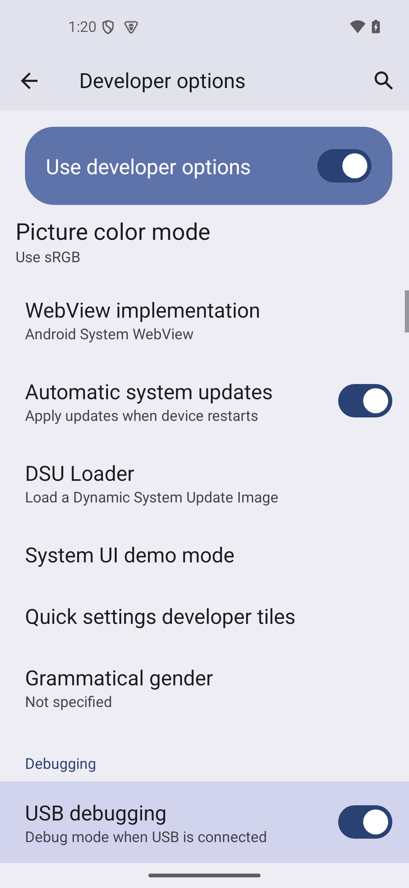

# ADB USB to Wi-Fi — Unplug and Keep Debugging

Plug in your Android phone, enable ADB over Wi-Fi, then unplug and keep debugging. Open Wireless Debugging is a desktop app for macOS, Windows, and Linux. ADB is included.

## Download 1.0.5

| Platform | Download | SHA-256 | Open after extracting |
| --- | --- | --- | --- |
| macOS 12 or later · Intel and Apple Silicon | [ZIP][macos] | [Checksum][macos-sha] | `Open Wireless Debugging.app` |
| Windows 10 or 11 · x64 | [ZIP][windows] | [Checksum][windows-sha] | `Open Wireless Debugging.exe` |
| Linux · x64 | [TAR.GZ][linux-x64] | [Checksum][linux-x64-sha] | `open-wireless-debugging` |
| Linux · ARM64 | [TAR.GZ][linux-arm64] | [Checksum][linux-arm64-sha] | `open-wireless-debugging` |

Extract the entire archive into one folder before opening the app. Keep the bundled files together. Linux needs a graphical desktop with GTK 3 and USB access.

[Release notes][release] · [Set up USB debugging](#1-enable-usb-debugging) · [Switch to Wi-Fi](#2-enable-adb-over-wi-fi) · [Connect with adb toolbox](#3-connect-with-adb-toolbox) · [Troubleshooting](#troubleshooting)

## 1. Enable USB debugging

1. On your phone, open **Settings → About phone** and find **Build number**. On Samsung Galaxy, look under **Software information**. If your menus look different, search Settings for **Build number**.
2. Tap **Build number** seven times. Enter your device PIN if prompted and wait for Android to confirm that Developer options are enabled.
3. Go back to Settings, open **Developer options**, and turn on **USB debugging**. Depending on your phone, Developer options may be under **System**.
4. Unlock the phone and connect it to your computer with a USB data cable. When Android asks **Allow USB debugging?**, tap **Allow**. If the prompt hasn’t appeared, leave the phone unlocked and check again after opening the desktop app.

[Nextaix’s original English guide to USB debugging][nextaix-guide]

## 2. Enable ADB over Wi-Fi

1. Open **Open Wireless Debugging** from the extracted folder. If the app opens in a different language, use the **Language** menu to switch to English.
2. Find your phone under **USB devices**. Once it shows **Ready**, select it and click **Enable wireless debugging**. If several phones are connected, select only the ones you want to enable.
3. Keep the cable connected while the app is enabling wireless debugging. When the device row says **Wireless debugging is on**, you can unplug that phone.
4. If you’ll connect from another device, note the address displayed under the success message. If no address appears, look up the phone’s IP address in its network settings and use port `5555`.

## 3. Connect with adb toolbox

Open adb toolbox on your Android device. If you need to install it, get [ADB Shell – Debug Toolbox on Google Play][adb-toolbox].

### Connect to the same phone

1. On the phone you just enabled, open **Devices**, tap **Add new device**, and choose **Local connection**.
2. Choose **Universal method**, tap **Continue**, and turn off **Pairing code**.
3. Enter `127.0.0.1` as the IP address and `5555` as the connection port. Tap **Connect**. The same-phone connection works without Wi-Fi.

### Connect to another phone

1. Connect both phones to the same trusted Wi-Fi network. Use the IP address shown for the target phone in the desktop app or look it up on that phone.
2. On the phone running adb toolbox, open **Devices**, tap **Add new device**, and choose **Remote connection**.
3. Choose **Universal method**, tap **Continue**, and turn off **Pairing code**. If an introductory guide appears, dismiss it and scroll back to the connection form.
4. In **IP address or domain**, enter the target phone’s IP. In **Connection port**, enter `5555`, then tap **Connect**. The screenshot shows `192.0.2.10` as an example. Use your phone’s actual IP.

Back on the **Devices** page, confirm the phone shows **Connected**. Tap its gear icon and choose **Select this device** to use it in adb toolbox.

## Troubleshooting

| What you see | What to try |
| --- | --- |
| macOS blocks the first launch | The app is ad hoc signed. Try opening it, then go to **System Settings → Privacy & Security → Open Anyway** and confirm. On a managed Mac, ask your administrator. [Apple’s instructions][apple-gatekeeper] |
| The phone doesn’t appear or is waiting for authorization | Unlock it, check that USB debugging is on, and accept the prompt. Reconnect the cable or try another USB data cable or port. |
| Windows still can’t see the phone | Install the appropriate [USB driver][android-drivers] for your device, then reconnect it. |
| Linux reports a USB permission error | Check your distribution’s Android udev rules and USB group permissions, then reconnect the phone. [Android’s device setup instructions][android-usb-setup] |
| The device keeps disappearing or activation fails | Close other desktop tools using ADB, reconnect and authorize the phone, then choose **Retry failed attempts** when it becomes available. If the device is still working, leave the cable in until it finishes. |
| adb toolbox can’t connect | Check that **Pairing code** is off and the port is `5555`. For another phone, check its current IP and use the same Wi-Fi network. Guest networks may block connections between devices. |
| The phone rebooted | Reconnect it over USB and enable ADB over Wi-Fi again. |
| The phone changed Wi-Fi networks | Look up its new IP address and use that address with port `5555`. If only the IP changed, try reconnecting before repeating the USB setup. |

On supported Android 11 and later devices, Android’s built-in [Wireless debugging][android-wireless] also offers a pairing-code workflow.

[release]: https://github.com/jarhot1992/adb-usb-to-wifi/releases/tag/v1.0.5
[macos]: https://github.com/jarhot1992/adb-usb-to-wifi/releases/download/v1.0.5/Open-Wireless-Debugging-1.0.5-macos.zip
[macos-sha]: https://github.com/jarhot1992/adb-usb-to-wifi/releases/download/v1.0.5/Open-Wireless-Debugging-1.0.5-macos.zip.sha256
[windows]: https://github.com/jarhot1992/adb-usb-to-wifi/releases/download/v1.0.5/Open-Wireless-Debugging-1.0.5-windows.zip
[windows-sha]: https://github.com/jarhot1992/adb-usb-to-wifi/releases/download/v1.0.5/Open-Wireless-Debugging-1.0.5-windows.zip.sha256
[linux-x64]: https://github.com/jarhot1992/adb-usb-to-wifi/releases/download/v1.0.5/Open-Wireless-Debugging-1.0.5-linux-x64.tar.gz
[linux-x64-sha]: https://github.com/jarhot1992/adb-usb-to-wifi/releases/download/v1.0.5/Open-Wireless-Debugging-1.0.5-linux-x64.tar.gz.sha256
[linux-arm64]: https://github.com/jarhot1992/adb-usb-to-wifi/releases/download/v1.0.5/Open-Wireless-Debugging-1.0.5-linux-arm64.tar.gz
[linux-arm64-sha]: https://github.com/jarhot1992/adb-usb-to-wifi/releases/download/v1.0.5/Open-Wireless-Debugging-1.0.5-linux-arm64.tar.gz.sha256
[nextaix-guide]: https://nextaix.com/adb-help/tutorials/usb-debugging
[adb-toolbox]: https://play.google.com/store/apps/details?id=com.github.standardadb
[apple-gatekeeper]: https://support.apple.com/en-us/102445
[android-drivers]: https://developer.android.com/studio/run/oem-usb
[android-usb-setup]: https://developer.android.com/studio/run/device#setting-up
[android-wireless]: https://developer.android.com/studio/run/device#wireless
