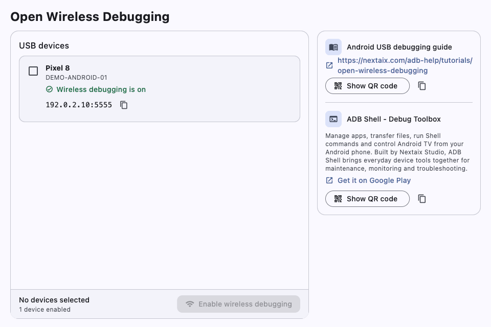
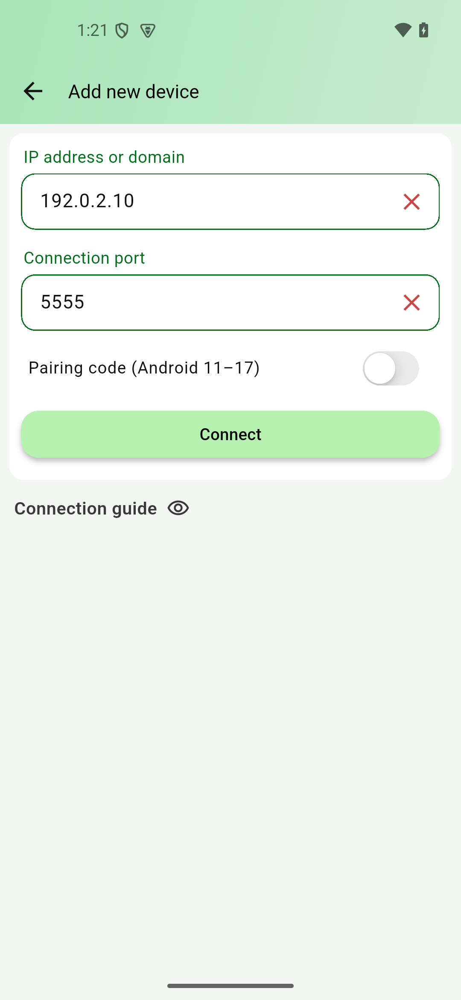

# ADB USB to Wi-Fi — Unplug and Keep Debugging

Use Open Wireless Debugging to switch your Android phone from USB to Wi-Fi. ADB comes with the desktop app. Once wireless debugging is on, you can unplug the cable.

## Download 1.0.6

Each download is under 25 MB.

| Platform | Download | SHA-256 | Open after extracting |
| --- | --- | --- | --- |
| macOS 12 or later · Apple Silicon | [ZIP][macos-arm64] | [Checksum][macos-arm64-sha] | `Open Wireless Debugging.app` |
| macOS 12 or later · Intel | [ZIP][macos-x64] | [Checksum][macos-x64-sha] | `Open Wireless Debugging.app` |
| Windows 10 or 11 · x64 | [ZIP][windows] | [Checksum][windows-sha] | `Open Wireless Debugging.exe` |
| Linux · x64 | [TAR.XZ][linux-x64] | [Checksum][linux-x64-sha] | `open-wireless-debugging` |
| Linux · ARM64 | [TAR.XZ][linux-arm64] | [Checksum][linux-arm64-sha] | `open-wireless-debugging` |

On macOS, choose **Apple Silicon** if About This Mac shows an Apple chip and **Intel** if it shows an Intel processor. Open the ZIP in Finder. On Windows, right-click the ZIP and choose **Extract All**. On Linux, use your archive manager or run `tar -xJf <filename>.tar.xz`. Open the app from the extracted folder. Linux needs a graphical desktop with GTK 3 and USB access.

[Release notes][release] · [Set up USB debugging](#1-enable-usb-debugging) · [Switch to Wi-Fi](#2-enable-adb-over-wi-fi) · [Connect with adb toolbox](#3-connect-with-adb-toolbox) · [Troubleshooting](#troubleshooting)

## 1. Enable USB debugging

1. Find **Build number** under **Settings → About phone**. On a Samsung Galaxy, look under **Software information**. You can also search Settings for **Build number**.
2. Tap **Build number** seven times. If Android asks for your PIN, enter it. You’ll see a message when Developer options are on.
3. Go back to Settings and turn on **USB debugging** in **Developer options**. Some phones put Developer options under **System**.
4. Unlock your phone and plug it into your computer with a USB data cable. Tap **Allow** when the phone asks **Allow USB debugging?**. The prompt may appear after you open the desktop app.

[Nextaix’s original English guide to USB debugging][nextaix-guide]

## 2. Enable ADB over Wi-Fi

1. Start **Open Wireless Debugging** from the folder you extracted. You can switch to English in the **Language** menu.
2. Under **USB devices**, wait for your phone to show **Ready**. Select it and click **Enable wireless debugging**. If you have several phones plugged in, select each one you want to use wirelessly.
3. Wait until you see **Wireless debugging is on** next to your phone before unplugging it.
4. For connections from another device, copy the address below **Wireless debugging is on**.

## 3. Connect with adb toolbox

Open adb toolbox on the phone you’ll connect from. You’ll find it on Google Play as [ADB Shell – Debug Toolbox][adb-toolbox].

### Connect to the same phone

1. On the same phone, go to **Devices → Add new device → Local connection**.
2. Choose **Universal method**, tap **Continue**, and turn off **Pairing code**.
3. Enter `127.0.0.1` for the IP address and `5555` for the port. Tap **Connect**. You can do this with Wi-Fi off.

### Connect to another phone

1. Put both phones on the same trusted Wi-Fi network. Copy the IP address of the phone you want to connect to from the desktop app, or check that phone’s network settings.
2. In adb toolbox, go to **Devices → Add new device → Remote connection**.
3. Choose **Universal method**, tap **Continue**, and turn off **Pairing code**. If a guide pops up, close it and scroll back to the top of the form.
4. Enter the other phone’s IP under **IP address or domain** and `5555` under **Connection port**. Tap **Connect**. The IP in the screenshot is just an example.

Go back to **Devices** and look for **Connected**. Tap the gear next to the phone and choose **Select this device**.

## Troubleshooting

| What you see | What to try |
| --- | --- |
| macOS blocks the first launch | The app is ad hoc signed. Try opening it, then go to **System Settings → Privacy & Security → Open Anyway** and confirm. On a managed Mac, ask your administrator. [Apple’s instructions][apple-gatekeeper] |
| The phone doesn’t show up | Unlock it, turn on **USB debugging**, and tap **Allow** if prompted. Still missing? Try another USB port or data cable. |
| Windows still can’t see the phone | Install the appropriate [USB driver][android-drivers] for your device, then reconnect it. |
| Linux reports a USB permission error | Check your distribution’s Android udev rules and USB group permissions, then reconnect the phone. [Android’s device setup instructions][android-usb-setup] |
| The phone keeps disappearing or setup fails | Close other apps using ADB, plug the phone back in, and tap **Allow** if prompted. Once the phone is **Ready**, click **Retry failed attempts**. |
| adb toolbox can’t connect | Check that **Pairing code** is off and the port is `5555`. For another phone, check its current IP and use the same Wi-Fi network. Guest networks may block connections between devices. |
| The phone rebooted | Reconnect it over USB and enable ADB over Wi-Fi again. |
| The phone changed Wi-Fi networks | Find the new IP in the phone’s network settings and reconnect on port `5555`. If only the IP changed, try reconnecting before setting up USB again. |

If your phone runs Android 11 or later and has a [Wireless debugging][android-wireless] setting, you can also connect with a pairing code.

[release]: https://github.com/jarhot1992/adb-usb-to-wifi/releases/tag/v1.0.6
[macos-arm64]: https://github.com/jarhot1992/adb-usb-to-wifi/releases/download/v1.0.6/Open-Wireless-Debugging-1.0.6-macos-arm64.zip
[macos-arm64-sha]: https://github.com/jarhot1992/adb-usb-to-wifi/releases/download/v1.0.6/Open-Wireless-Debugging-1.0.6-macos-arm64.zip.sha256
[macos-x64]: https://github.com/jarhot1992/adb-usb-to-wifi/releases/download/v1.0.6/Open-Wireless-Debugging-1.0.6-macos-x64.zip
[macos-x64-sha]: https://github.com/jarhot1992/adb-usb-to-wifi/releases/download/v1.0.6/Open-Wireless-Debugging-1.0.6-macos-x64.zip.sha256
[windows]: https://github.com/jarhot1992/adb-usb-to-wifi/releases/download/v1.0.6/Open-Wireless-Debugging-1.0.6-windows.zip
[windows-sha]: https://github.com/jarhot1992/adb-usb-to-wifi/releases/download/v1.0.6/Open-Wireless-Debugging-1.0.6-windows.zip.sha256
[linux-x64]: https://github.com/jarhot1992/adb-usb-to-wifi/releases/download/v1.0.6/Open-Wireless-Debugging-1.0.6-linux-x64.tar.xz
[linux-x64-sha]: https://github.com/jarhot1992/adb-usb-to-wifi/releases/download/v1.0.6/Open-Wireless-Debugging-1.0.6-linux-x64.tar.xz.sha256
[linux-arm64]: https://github.com/jarhot1992/adb-usb-to-wifi/releases/download/v1.0.6/Open-Wireless-Debugging-1.0.6-linux-arm64.tar.xz
[linux-arm64-sha]: https://github.com/jarhot1992/adb-usb-to-wifi/releases/download/v1.0.6/Open-Wireless-Debugging-1.0.6-linux-arm64.tar.xz.sha256
[nextaix-guide]: https://nextaix.com/adb-help/tutorials/usb-debugging
[adb-toolbox]: https://play.google.com/store/apps/details?id=com.github.standardadb
[apple-gatekeeper]: https://support.apple.com/en-us/102445
[android-drivers]: https://developer.android.com/studio/run/oem-usb
[android-usb-setup]: https://developer.android.com/studio/run/device#setting-up
[android-wireless]: https://developer.android.com/studio/run/device#wireless
