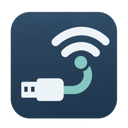
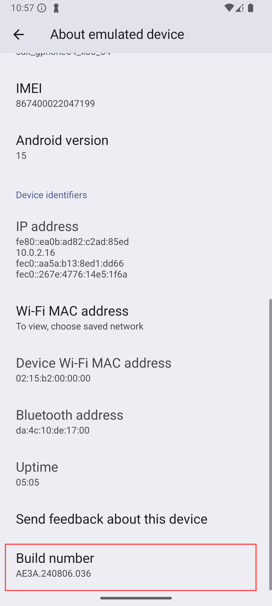
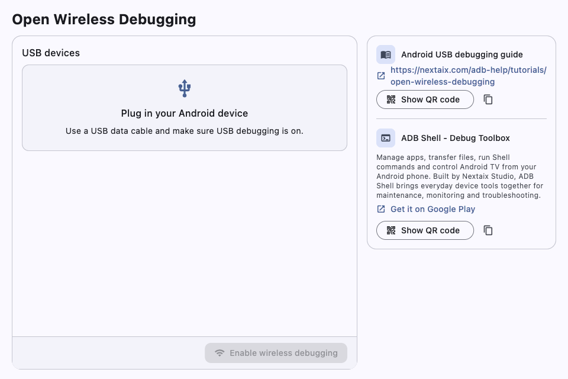
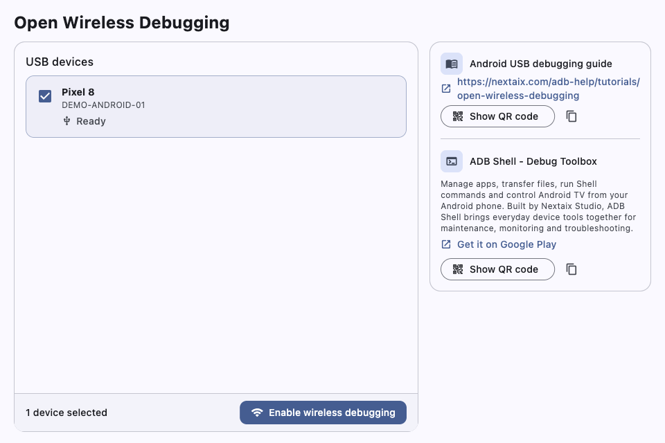
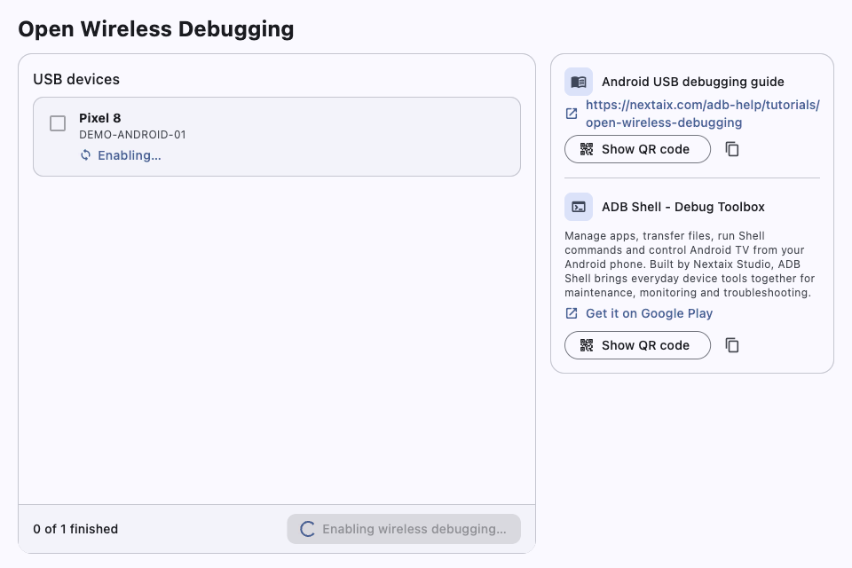

#  ADB USB to Wi-Fi

Use ADB USB to Wi-Fi to enable wireless debugging on an Android device from macOS, Windows, or Linux. Connect the device by USB for setup, then unplug it and continue debugging over Wi-Fi.

---

## Download 1.0.6

| Platform | Download | SHA-256 | Open after extracting |
| --- | --- | --- | --- |
| macOS 12 or later · Apple Silicon | [ZIP][macos-arm64] | [Checksum][macos-arm64-sha] | `Open Wireless Debugging.app` |
| macOS 12 or later · Intel | [ZIP][macos-x64] | [Checksum][macos-x64-sha] | `Open Wireless Debugging.app` |
| Windows 10 or 11 · x64 | [ZIP][windows] | [Checksum][windows-sha] | `Open Wireless Debugging.exe` |
| Linux · x64 | [TAR.XZ][linux-x64] | [Checksum][linux-x64-sha] | `open-wireless-debugging` |
| Linux · ARM64 | [TAR.XZ][linux-arm64] | [Checksum][linux-arm64-sha] | `open-wireless-debugging` |

Extract the archive and open the app listed for your platform.

- **On macOS**, check **About This Mac** to choose the Apple Silicon or Intel build.
- **On Windows**, right-click the ZIP and select **Extract All**.
- **On Linux**, use an archive manager or run `tar -xJf <filename>.tar.xz`. The app requires a graphical desktop with GTK 3 and USB access.

[Release notes][release]

---

##  ADB Shell for Android

After you enable wireless debugging with the desktop tool, open ADB Shell on your Android phone. You can connect to that phone directly or to another Android device on the same Wi-Fi network.

Run shell commands and inspect Logcat in the terminal. You can also manage installed apps, browse files, and transfer files between devices.

- **[Get ADB Shell on Google Play][adb-shell-play]**
- [Explore ADB Shell on Nextaix][adb-shell-website]

---

## Nextaix setup guides

- [Wireless debugging from a computer][nextaix-computer-guide]
- [USB debugging on Android][nextaix-usb-guide]

---

## Contents

- [Quick start](#quick-start)
- [Set up USB debugging](#1-enable-usb-debugging)
- [Enable ADB over Wi-Fi](#2-enable-adb-over-wi-fi)
- [Connect with ADB Shell](#3-connect-with-adb-shell)
- [Check the connection](#4-check-the-connection)
- [Troubleshooting](#troubleshooting)

## Quick start

1. Download and extract the desktop app for your platform.
2. Enable **USB debugging**, connect the unlocked phone with a USB data cable, and approve the debugging prompt when it appears.
3. Open the desktop app, select the phone, and click **Enable wireless debugging**. Unplug the cable once **Wireless debugging is on** appears.
4. Connect in ADB Shell using port `5555`.

## Before you start

- The desktop method works with Android 5.0 or later on devices that support ADB and allow USB debugging. Use a USB cable that supports data transfer.
- ADB Shell requires Android 7.0 or later. To debug a phone running Android 5 or 6, install ADB Shell on a second phone and follow the [remote connection steps](#connect-to-another-phone).
- This method uses port `5555` without a pairing code. On Android 11 or later, devices with a **Wireless debugging** switch in Settings also support [pairing directly on the phone](https://nextaix.com/adb-help/tutorials/local-connection).

## 1. Enable USB debugging

1. Open **Settings → About phone**. Tap **Build number** repeatedly until Android confirms that developer options are enabled. If the entry is missing, search Settings for **Build number**.

   

   *The location of **Build number** varies by phone.*
2. Return to Settings, open **Developer options**, and enable **USB debugging**.

   

   *The **USB debugging** switch in Developer options.*
3. Unlock the phone and connect it to the computer with a USB data cable.

   If the desktop app does not list the phone, see [Desktop launch and USB detection](#desktop-launch-and-usb-detection).
4. When **Allow USB debugging?** appears, tap **Allow**. If the prompt is delayed, open the desktop app and check the phone again.

If USB debugging is missing or grayed out, check the [instructions for your phone’s brand or operating system](https://nextaix.com/adb-help/tutorials/device-debugging-restrictions#device-brands).

## 2. Enable ADB over Wi-Fi

1. Open the desktop app from the extracted folder with the phone connected.

   

   *The desktop app while it waits for a USB device.*
2. Under **USB devices**, wait for the target phone to show **Ready**. Select its checkbox and click **Enable wireless debugging**. If several phones appear, select only the one you want to set up.

   

   *The **Enable wireless debugging** button is in the lower-right corner.*
3. Keep the cable connected while the app displays **Enabling…**.

   

   *The desktop app shows progress under the phone’s name.*
4. Unplug the phone once the green **Wireless debugging is on** message appears. The app also displays **Wireless debugging enabled** to confirm success.

   Continue with the [local connection](#connect-to-the-same-phone) or the [remote connection](#connect-to-another-phone) in ADB Shell.

   

   *Use the address below the green confirmation message for a remote connection. The example address is `192.0.2.10:5555`.*

## 3. Connect with ADB Shell

### Connect to the same phone

1. Open ADB Shell on the phone you just set up. In **Devices**, tap **Add new device** and choose **Local connection**.
2. Choose **Universal method**, then tap **Continue**. If **Getting started** appears, tap **OK** and scroll back to the top. Turn off **Pairing code**.
3. Enter `127.0.0.1` as the address and `5555` as the connection port, then tap **Connect**. This local connection works without Wi-Fi.

### Connect to another phone

1. Connect both phones to the same Wi-Fi network.
2. Find the target phone’s IP address in the desktop app. If the app does not show it, check the Wi-Fi settings on the target phone.
3. Open ADB Shell on the phone you will connect from. In **Devices**, tap **Add new device** and choose **Remote connection**.
4. Choose **Universal method**, then tap **Continue**. If **Getting started** appears, tap **OK** and scroll back to the top. Turn off **Pairing code**.
5. In **IP address or domain**, enter the IP address you noted. Enter `5555` in **Connection port**, then tap **Connect**.

   

   *Replace the example IP address with the target phone’s address and keep port `5555`.*

## 4. Check the connection

1. Return to **Devices** and check that the phone shows **Connected**.
2. Tap the gear next to the phone and choose **Select this device**. Wait for **Device selected**.
3. Open **Terminal**. Select the device under **Device list** or switch to its existing tab. Run `pwd`. A directory path, including `/`, confirms that the device is responding.

   If the command produces no output, see [troubleshooting ADB commands](https://nextaix.com/adb-help#faq-command-not-working).

## Troubleshooting

### Desktop launch and USB detection

- **macOS cannot verify the app’s developer**

  Attempt to open the app once. Then go to **System Settings → Privacy & Security**, click **Open Anyway**, and confirm. If your organization manages the Mac, contact your administrator.

  [Apple’s guide to opening apps on your Mac](https://support.apple.com/102445)

- **The app does not list the phone or USB authorization is pending**

  Unlock the phone and check that **USB debugging** is on. If you see **Allow USB debugging?**, tap **Allow**.

  If the phone still does not appear, reconnect the USB cable. Try another data cable or USB port if needed.

- **Windows cannot detect the phone or Linux reports a USB permissions error**

  On Windows, install the [USB driver from the phone manufacturer](https://developer.android.com/studio/run/oem-usb). On a Windows ARM64 computer, use a driver that supports ARM64.

  For a USB permissions error on Linux, follow [Android’s USB debugging setup instructions](https://developer.android.com/studio/run/device#setting-up) to grant your user account access to the USB device.

  After installing the driver or fixing permissions, reconnect the USB cable and reopen the app.

- **The device list refreshes repeatedly or the phone disappears**

  Close other tools that use ADB and reopen Open Wireless Debugging. If the phone still disconnects, check for updates to your desktop debugging tools.

- **An older version of ADB cannot detect a Samsung phone**

  If your computer’s debugging tool comes with ADB, update the tool first. If you installed Google Platform-Tools separately, update to version 36.0.2 or later.

  [Google Platform-Tools release notes](https://developer.android.com/tools/releases/platform-tools#3602_sep_2025)

### Wireless debugging setup

- **The Enable wireless debugging button is unavailable**

  Wait for any setup marked **Enabling…** to finish. If the button remains unavailable, select a phone marked **Ready**.

- **Setup fails after you click Enable wireless debugging**

  Check the error next to the device. If the app displays **Unlock your device, then tap Allow**, unlock the phone and approve the debugging prompt. If the USB connection dropped, reconnect the cable.

  Click **Retry failed attempts** to try again for phones marked **Ready**. If the device list shows an error, click **Retry** to refresh the list.

  On supported devices running Android 11 or later, you can also use the [system pairing option](#before-you-start).

### Connection failures and reconnection

- **Wireless debugging is enabled but ADB Shell cannot connect**

  For a local connection, check the [address and port](#connect-to-the-same-phone) and confirm that **Pairing code** is off.

  For a remote connection, check the [target IP address and port](#connect-to-another-phone) and join the same Wi-Fi network on both phones. Guest networks may block connections between devices.

- **The phone restarted or changed Wi-Fi networks**

  After a restart, you will usually need to reconnect the phone by USB and [enable wireless debugging again](#2-enable-adb-over-wi-fi).

  After changing networks, join the same Wi-Fi network on both phones. If port `5555` is still active, reconnect using the target phone’s new IP address and the same port.

Chromebook and Waydroid

- **“Develop Android apps” is missing after a Chromebook update**

  Check for updates in **Settings → About ChromeOS**. Then look for **Develop Android apps** in the Linux development environment settings.

- **ADB is unavailable on a managed Chromebook**

  If your Chromebook is managed by a school or company, ask your administrator whether ADB debugging can be enabled.

  [ChromeOS ADB debugging restrictions](https://developers.google.com/chromeos/app-development/develop/deploying-apps#enable-adb-debug)

- **Another computer cannot detect the Chromebook over USB**

  Check the supported models list for USB debugging support and the correct port. To connect over Wi-Fi, follow the ChromeOS network debugging guide.

  [Chromium’s list of USB debugging models and ports](https://www.chromium.org/chromium-os/chrome-os-systems-supporting-adb-debugging-over-usb/)

  [ChromeOS network debugging guide](https://developers.google.com/chromeos/app-development/develop/deploying-apps#connect-to-adb-over-a-network)

- **The Linux host can connect to Waydroid but the phone cannot**

  On Waydroid’s default network, the phone cannot reach the IP address that Waydroid displays. Follow the connection guide on the Linux computer running Waydroid.

  [Official Waydroid ADB connection guide](https://docs.waydro.id/faq/using-adb-with-waydroid)

If debugging is unavailable or pairing fails, see [ADB connection and permission problems](https://nextaix.com/adb-help/tutorials/device-debugging-restrictions) for your model.

If a command returns `Permission denied` after you connect, see [ADB permission troubleshooting](https://nextaix.com/adb-help#faq-permission-denied).

[release]: https://github.com/jarhot1992/adb-usb-to-wifi/releases/tag/v1.0.6
[macos-arm64]: https://github.com/jarhot1992/adb-usb-to-wifi/releases/download/v1.0.6/Open-Wireless-Debugging-1.0.6-macos-arm64.zip
[macos-arm64-sha]: https://github.com/jarhot1992/adb-usb-to-wifi/releases/download/v1.0.6/Open-Wireless-Debugging-1.0.6-macos-arm64.zip.sha256
[macos-x64]: https://github.com/jarhot1992/adb-usb-to-wifi/releases/download/v1.0.6/Open-Wireless-Debugging-1.0.6-macos-x64.zip
[macos-x64-sha]: https://github.com/jarhot1992/adb-usb-to-wifi/releases/download/v1.0.6/Open-Wireless-Debugging-1.0.6-macos-x64.zip.sha256
[windows]: https://github.com/jarhot1992/adb-usb-to-wifi/releases/download/v1.0.6/Open-Wireless-Debugging-1.0.6-windows.zip
[windows-sha]: https://github.com/jarhot1992/adb-usb-to-wifi/releases/download/v1.0.6/Open-Wireless-Debugging-1.0.6-windows.zip.sha256
[linux-x64]: https://github.com/jarhot1992/adb-usb-to-wifi/releases/download/v1.0.6/Open-Wireless-Debugging-1.0.6-linux-x64.tar.xz
[linux-x64-sha]: https://github.com/jarhot1992/adb-usb-to-wifi/releases/download/v1.0.6/Open-Wireless-Debugging-1.0.6-linux-x64.tar.xz.sha256
[linux-arm64]: https://github.com/jarhot1992/adb-usb-to-wifi/releases/download/v1.0.6/Open-Wireless-Debugging-1.0.6-linux-arm64.tar.xz
[linux-arm64-sha]: https://github.com/jarhot1992/adb-usb-to-wifi/releases/download/v1.0.6/Open-Wireless-Debugging-1.0.6-linux-arm64.tar.xz.sha256
[nextaix-usb-guide]: https://nextaix.com/adb-help/tutorials/usb-debugging
[adb-shell-play]: https://play.google.com/store/apps/details?id=com.github.standardadb
[nextaix-computer-guide]: https://nextaix.com/adb-help/tutorials/open-wireless-debugging
[adb-shell-website]: https://nextaix.com/adb-shell
